# C++ Selected Solution Paths

Each scenario image compares the fewest-configuration success, the most-configuration success, and the fastest success.

## Full-Scenario Overviews

### Fewest Configurations

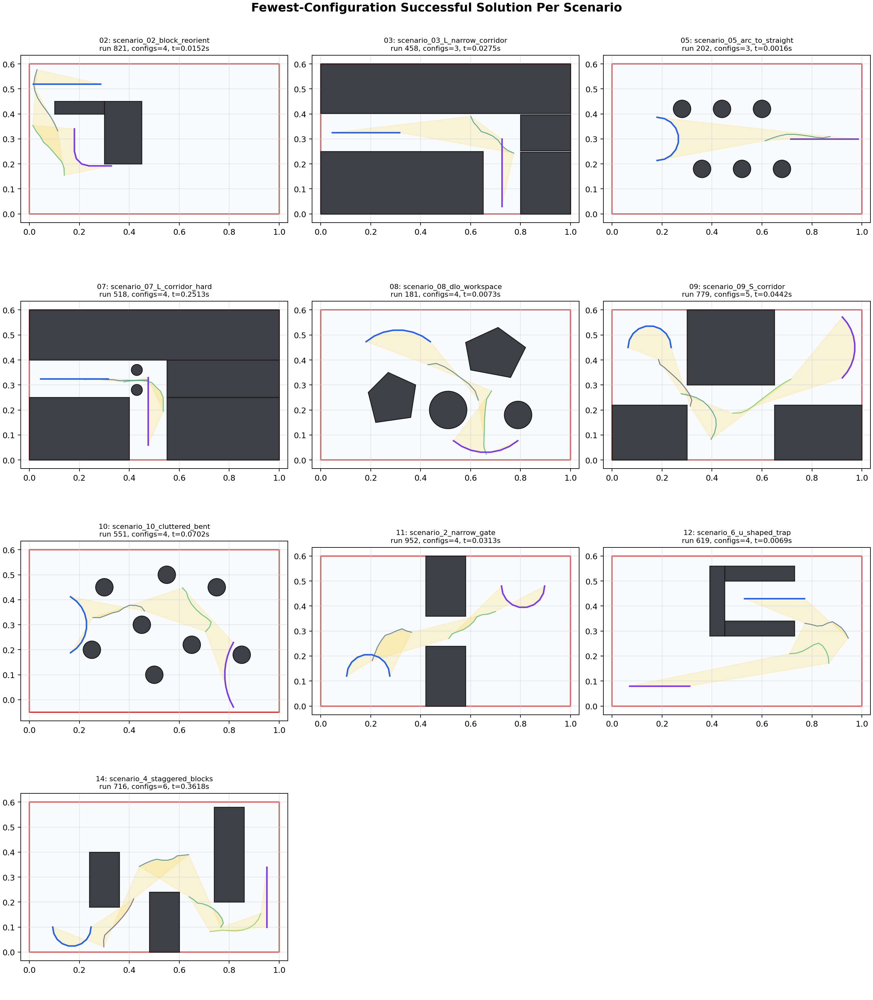

### Most Configurations

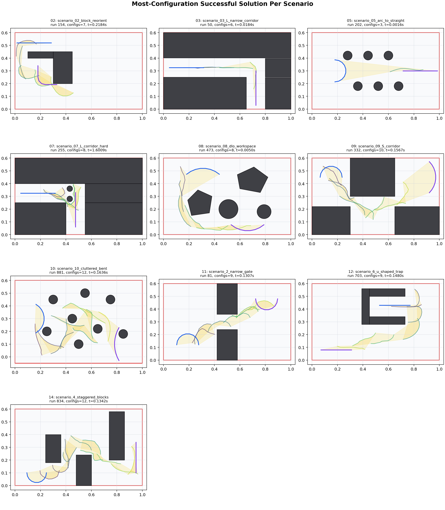

### Fastest Success

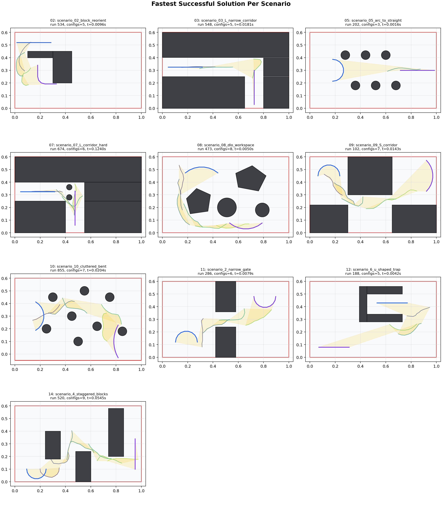

## Per-Scenario Comparisons

## 02: `scenario_02_block_reorient`

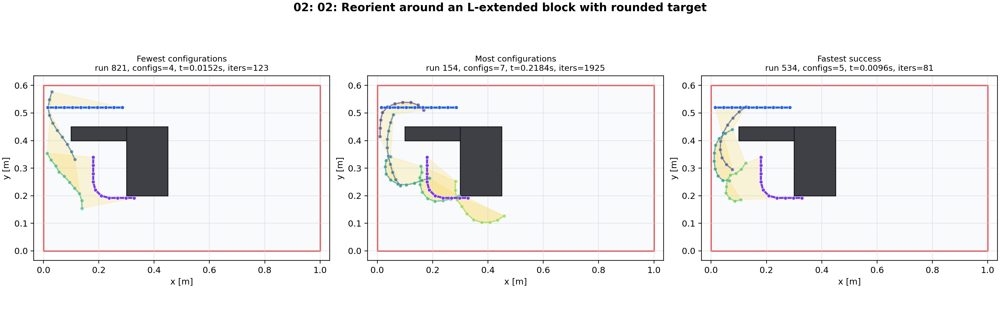

## 03: `scenario_03_L_narrow_corridor`

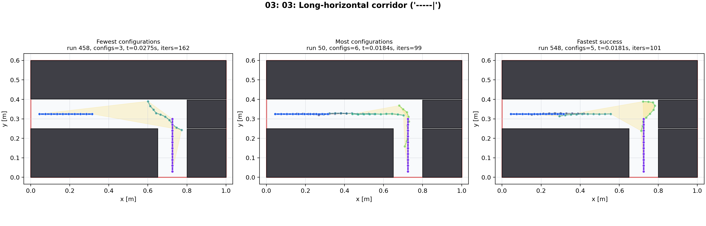

## 05: `scenario_05_arc_to_straight`

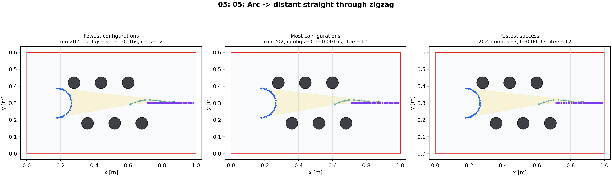

## 07: `scenario_07_L_corridor_hard`

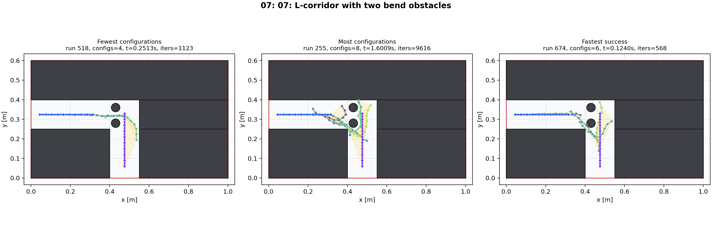

## 08: `scenario_08_dlo_workspace`

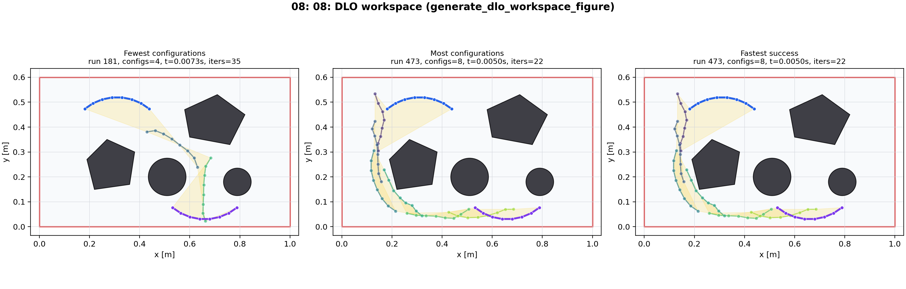

## 09: `scenario_09_S_corridor`

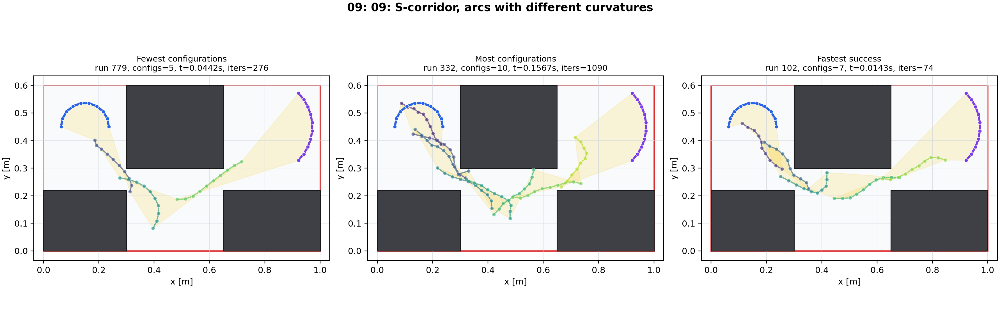

## 10: `scenario_10_cluttered_bent`

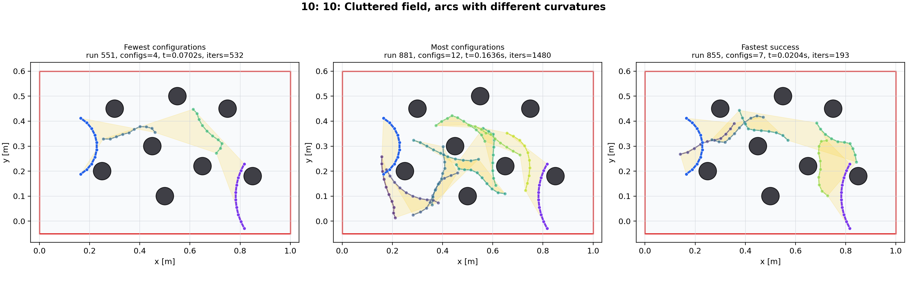

## 11: `scenario_2_narrow_gate`

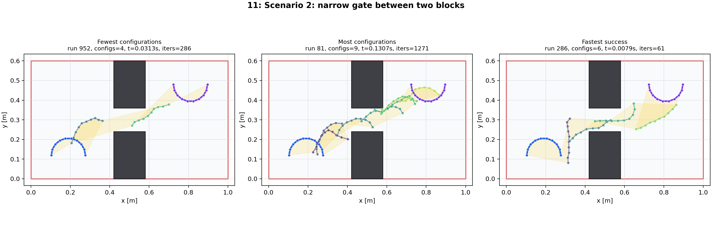

## 12: `scenario_6_u_shaped_trap`

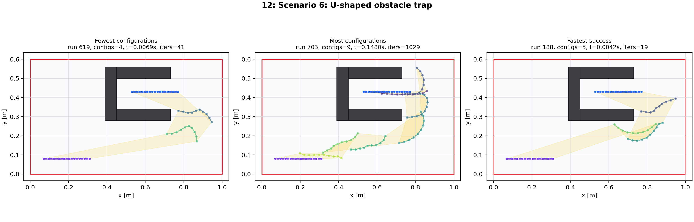

## 14: `scenario_4_staggered_blocks`

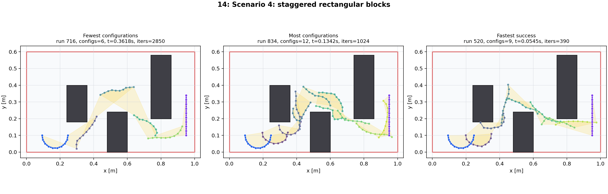
